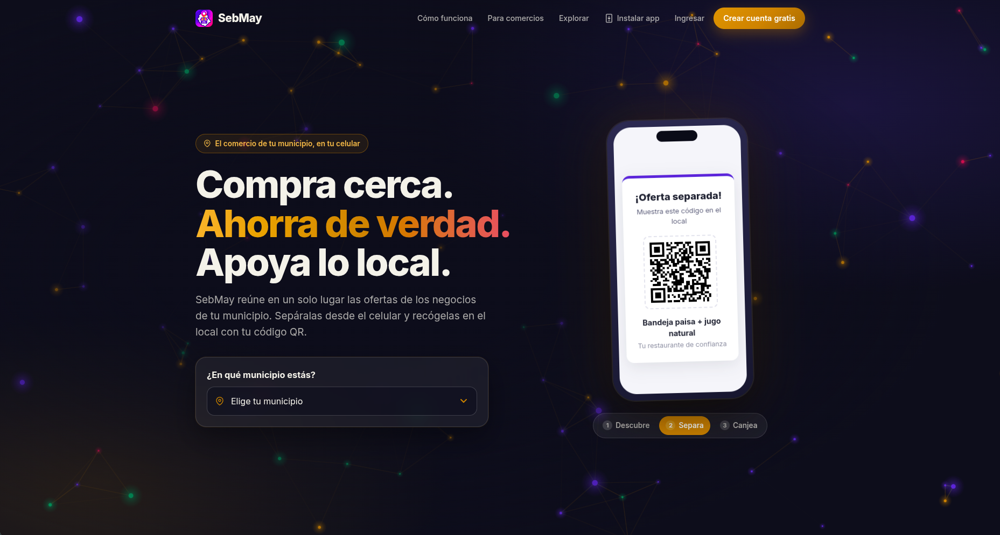
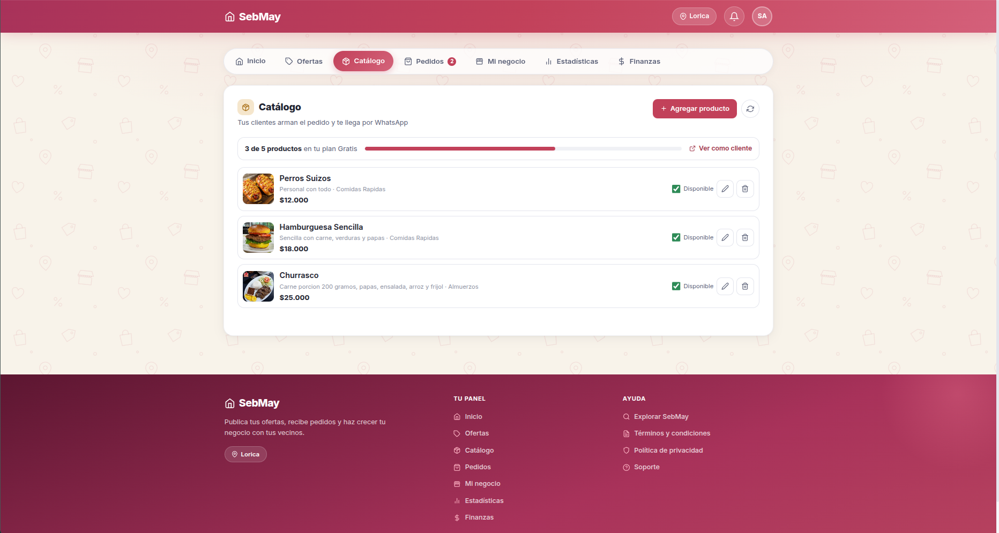
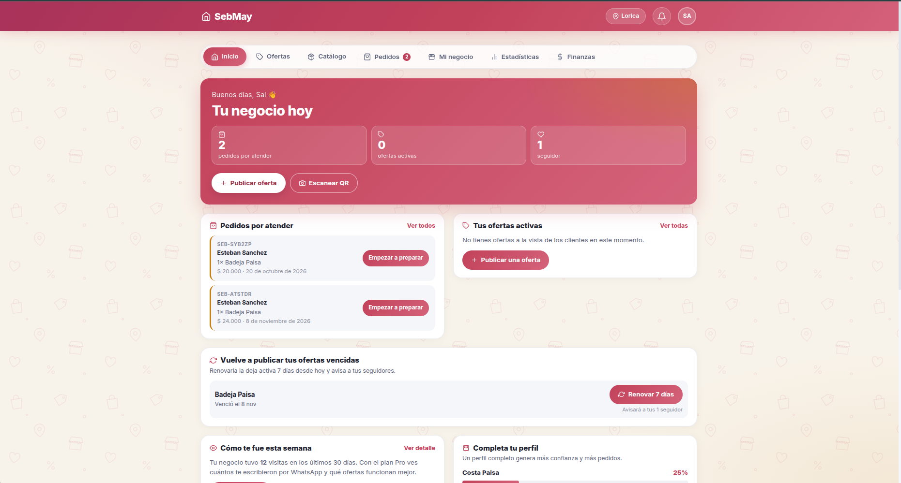

# SebMay · Marketplace para negocios locales

**En vivo:** [enlace](https://www.sebmay.com.co) · **Modelo:** suscripción para vendedores

> El código fuente es privado porque maneja datos de usuarios y negocios. Con gusto lo muestro en una entrevista.

## El problema

Los negocios pequeños no tienen dónde vender en línea sin pagar comisiones altas ni saber de tecnología.

## La solución

Un marketplace de dos lados: los negocios publican su catálogo con una suscripción, y los clientes encuentran ofertas de su municipio y hacen el pedido.

## Qué hice

Diseño de la arquitectura, modelado del dominio, API REST, frontend, integración de pagos con Wompi, documentación técnica y despliegue.

## Stack

| Capa | Tecnología |
| --- | --- |
| Frontend | React 18, TypeScript, Vite, Tailwind CSS |
| Backend | Node.js, Express, API REST |
| Base de datos | PostgreSQL, Prisma ORM |
| Pagos | Wompi |

## Decisiones técnicas

- **Frontend y API separados**, pensado para crecer a una app móvil que use la misma API.
- **Prisma ORM** para tener el modelo de datos tipado de punta a punta con TypeScript.
- **Interfaz simple** para comerciantes con poco conocimiento técnico.

## Lo que falló y cómo lo resolví

**Redirecciones de pago sin validar.** Tres pantallas de pago redirigían a la URL que devolvía la API sin revisarla, así que un dato alterado podía llevar al usuario a un sitio falso. Lo centralicé en una sola función, `irAlCheckoutWompi`, que solo redirige si la URL empieza por `https://checkout.wompi.co/`; si no, muestra un error. Además dejé de registrar el error completo en la consola, para no exponer datos internos.

## Capturas

| Catálogo | Panel del vendedor |
| --- | --- |
|  |  |

[Ver video demo](docs/sebmay.mp4)

---

Hecho por **Edinson Rivera** · [Portafolio](https://portafolio-desarrollo2026.vercel.app/) · [LinkedIn](https://www.linkedin.com/in/edinson-rivera-dev)# sebmay-case-study
